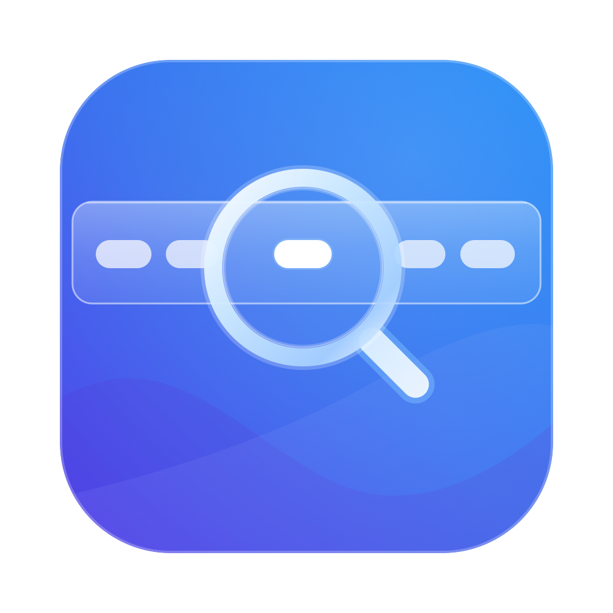
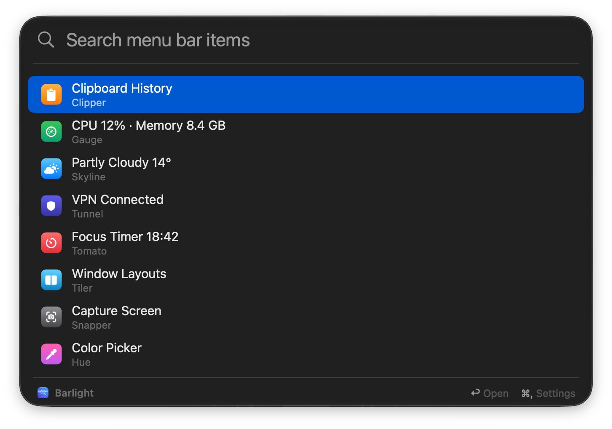

<p align="center"></p>

# Barlight

Find any menu bar item without hunting for it.

Menu bars fill up fast. When you already know what you want, scanning a row of tiny icons to find it is wasted time. With Barlight you press a hotkey, type part of the item's name, and press Return to open its menu. Your hands never leave the keyboard.

It finds every item, including the ones macOS hides behind the » overflow chevron when the bar runs out of space.

<p align="center"></p>

## Install

1. Download `Barlight-<version>.zip` from [Releases](https://github.com/andershaga/barlight/releases) and unzip it.
2. Move `Barlight.app` to `/Applications` and open it.
3. macOS says it can't verify the app, because Barlight isn't notarized. Click **Done**, then go to System Settings › Privacy & Security and click **Open Anyway** next to Barlight. You only do this once.
4. Follow the welcome window to grant Accessibility. Barlight then restarts and is ready.

Works on Apple silicon and Intel Macs.

## Use

| Key | Action |
|---|---|
| ⇧⌘Space | Open Barlight (change it in Settings) |
| Type | Filter by item or app name |
| ↑ ↓ | Move the selection |
| Return | Open the item's menu |
| ⌥Return | Open the item's right-click menu |
| ⌘, | Open Settings |
| Esc | Close |

Items you open often move to the top.

## Settings

- **Search hotkey:** any combination with ⌘, ⌥ or ⌃.
- **Open Barlight at login.**
- **Show system items:** Clock, Wi‑Fi, Sound and other Apple items. Off by default.
- **Items behind »:** choose how hidden items are found:
  - **Remember items when seen** (default): instant, with no flicker. An item must have been visible once.
  - **Reveal with » on every open:** always complete, with a brief flicker. Nothing is saved.

## Requirements

- macOS 26 or later.
- **Accessibility** permission. Barlight reads and presses menu bar items through the Accessibility API. It needs no Screen Recording permission and makes no network access.

## Build

You need Swift 6.2 or later. The Xcode Command Line Tools are enough.

```bash
scripts/build-app.sh
```

This builds `Barlight.app` in `~/Library/Caches/Barlight-build/`, ad-hoc signed. Copy it to `/Applications` and open it. The welcome window walks you through granting Accessibility.

Ad-hoc signed builds lose the Accessibility grant on every rebuild, so grant it again after each one.

To build a universal release zip in `dist/`:

```bash
scripts/release.sh
```

To regenerate the app icon from `Resources/AppIcon.svg`:

```bash
swift scripts/make-icon.swift
```

## Debugging

```bash
Barlight.app/Contents/MacOS/Barlight --dump       # one scan, printed as a table
Barlight.app/Contents/MacOS/Barlight --dump-raw   # every Accessibility element in the menu bar
open Barlight.app --args --demo                   # panel with stock macOS items, for screenshots
```

Logs use the subsystem `digital.haga.Barlight`:

```bash
log stream --predicate 'subsystem == "digital.haga.Barlight"'
```

## Credits

Inspired by [Ice](https://github.com/jordanbaird/Ice) by Jordan Baird and [Thaw](https://github.com/thaw-app/Thaw), which builds on Ice, and especially their menu bar search panels. Barlight is written from scratch and contains no code from either.

## License

[MIT](LICENSE)
